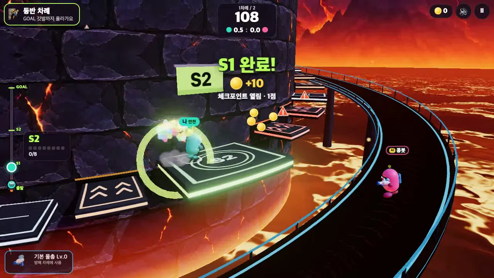

# Lava VS Stair (웹)

거대한 화산암 탑의 외벽 계단을 오르고, 상대 차례에는 바깥 통로에서 물총으로 방해하는 3D 아케이드 파티 게임.
설치·회원가입·로그인 없이 브라우저에서 바로 한다.



플레이 영상: [docs/media/gameplay.mp4](docs/media/gameplay.mp4) (57초) · 화면: [docs/media/](docs/media/)

## 실행

```sh
npm install        # 온라인 대전용 ws 하나. AI 대전만 할 거면 생략해도 된다
npm start          # → http://localhost:8787
```

- `바로 플레이`: AI와 2대2 한 경기(등반 한 번, 방해 한 번). Coins·물총·강화는 같은 브라우저에 저장된다.
- `친구와 대전`: 별명을 입력하면 접속한 사람과 방 목록이 실시간으로 보인다. 방 제목을 눌러 들어가거나, 제목을 정해 내 방을 만든다. 친구 이름 옆의 `초대`를 누르면 상대 화면에 `같이 하기` 버튼이 뜬다(방 밖에서 초대하면 방도 함께 만든다). 2~4명이 함께하고 빈 자리는 AI.
  같은 별명은 겹치지 않게 안내하며, 게임 중인 방과 꽉 찬 방은 입장을 막는다. 방에서 나가면 친구 목록으로 돌아가고, 친구 만나기를 닫으면 접속 목록에서도 빠진다.
  밖에 있는 친구에게 보내는 초대 링크(`?room=코드`)는 방 하단의 접힌 메뉴에 있다.
  서버 한 대에 모두 접속해야 하므로 인터넷 너머 친구와 하려면 이 서버를 공개 주소로 띄우거나 터널을 쓴다.
- `public/`은 정적 파일이라 아무 정적 호스팅에 올려도 AI 대전은 그대로 된다(온라인만 `server.js` 필요).

## 웹 배포

- 플레이: https://rnawhale.github.io/lava-vs-stair/ — AI 대전과 친구 대전 모두 지원한다. 개발 PC를 꺼도 접속할 수 있다. `main`의 `public/` 변경을 push하면 자동 배포된다.
- 대전 서버: https://lava-vs-stair.onrender.com — `render.yaml`로 정적 파일과 WebSocket 서버를 함께 올린다. 이 주소에서도 바로 플레이할 수 있다. `/health`가 `{"online":true}`를 반환하면 온라인 서버가 준비된 것이다.
- GitHub Pages는 저장소 Actions 변수 `LVS_ONLINE_URL`의 Render HTTPS 주소로 대전 서버에 연결한다. 이 값은 배포본의 `public/src/config.js`에만 적용된다. 서버를 옮기면 변수를 바꾸고 `Deploy game to GitHub Pages`를 실행한다. 서버 주소가 빠진 배포본은 준비 중이라는 안내를 표시한다.
- [Render 무료 서버](https://render.com/docs/free)는 15분 동안 사용하지 않으면 쉬고, 다음 접속 때 다시 켜지는 데 약 1분 걸릴 수 있다. 친구 대전 입장 시 서버가 준비될 때까지 기다린다. 개발 PC의 전원과는 무관하다. 서버를 다시 만들 때는 [Render 배포](https://render.com/deploy?repo=https://github.com/rnawhale/lava-vs-stair)를 사용한다.

## 조작

| | PC | 모바일 |
|---|---|---|
| 등반 | `D` 앞으로 · `A` 뒤로 · `W`/`S` 벽 쪽/바깥 · `Space` 점프(짧게 누르면 낮게) | 왼쪽 스틱 + 점프 버튼 |
| 방해 | 마우스 조준 · 클릭(누르고 있으면 연사) · `A`/`D` 통로 이동 | 화면을 누른 곳으로 조준·연사 + 스틱 |
| 기타 | `Esc` 일시정지 · `M` 음소거 · 방향키도 이동 | 우상단 버튼 |

## 규칙 요약

- 코스 S1/S2/S3 = 계단 6/8/10개. 주황 화살표 계단은 주기적으로 벽 속으로 접히고, 접히기 0.5초 전 빨간 점멸·떨림·`!` 표식·경고음으로 알린다. 흰 계단은 고정.
- 단계를 끝내면 체크포인트. 추락하면 2초 뒤 현재 단계 시작점에서 다시(완료 단계·Coins 유지, 재등장 2초 보호).
- 물총은 피해 없이 수평으로 밀친다. **땅에 붙어 있으면 조금, 점프 중에 맞으면 크게** 밀린다. 연두색 발판(출발·체크포인트·완주)은 안전 지대, 피격 후 0.75초 면역.
- 한 차례 최대 120초, 모두 완주하면 일찍 교대. 단계 점수 1/2/3점, 팀원당 평균으로 비교(동점이면 더 빨리 도달한 팀).
- 보상은 그 차례에 단계를 처음 끝낼 때 10/20/30 Coins(완주 합계 60).
- 물총: basic(무료, 사거리 60·간격 0.9·밀치기 15) / rapid(60 Coins, 45·0.45·8) / heavy(120 Coins, 60·1.6·24).
  강화 Lv.1 30 Coins, Lv.2 60 Coins → 발사 간격이 기본값의 95%/90%. 장비는 차례 시작 때 고정된다.
- AI는 `AI` 표시가 붙고, 이기면 한 단계 매워지고 지면 순해진다(순한맛 → 불지옥맛 5단계).

## 구조

| 경로 | 내용 |
|---|---|
| `public/src/config.js` | **모든 조정값**: 코스·조작감·규칙 시간·물총·보상·AI 난이도 |
| `public/src/course.js` `physics.js` `sim.js` `ai.js` | 렌더러 없는 순수 로직: 코스/계단 주기, 캐릭터 물리, 경기·물총·점수 규칙, AI |
| `public/src/view/` | three.js 화면: 탑·용암·계단·사격 통로, 캐릭터·물총 모델, 이펙트, 카메라 |
| `public/src/ui.js` `input.js` `audio.js` `save.js` | HUD·상점·결과·대기실, 키보드/마우스/터치, 효과음, localStorage 저장과 거래 |
| `public/src/net.js` `online.js` · `server.js` | 온라인: 서버가 친구·방 목록, 초대, 방 중계를 맡는다. 각자 자기 캐릭터만 계산해 알리고 방장이 진행·AI를 맡는다 |
| `public/vendor/three/` | three.js r187(MIT) 사본. 빌드 단계 없음 |
| `public/assets/` | 이미지와 효과음 28종. 없어도 절차 그래픽·합성음으로 동작 |
| `tools/` | 플레이 검증·밸런스 도구 |

## 검증

서버를 띄운 뒤 실행한다. 브라우저 검증은 설치된 Chrome을 Playwright로 열어 **실제 키보드·마우스·터치 이벤트**를 보낸다.

| 명령 | 내용 | 최근 결과 |
|---|---|---|
| `npm run check` | 규칙 자체 점검(물총 수치·강화, 거래 중복 방지, 저장 복구, 계단 기회, 점수·보호 규칙) | 115개 통과 |
| `npm run playtest` | 시작→세 단계 등반→추락·복귀→교대→물총 방해→보상→구매·강화·장착→새로고침 복구, 화면 크기 변경, 상점 열기/닫기, 재시작, 연속 클릭 | 37/37 |
| `npm run test:touch` | 모바일 에뮬레이션: 스틱·점프(멀티 터치)·화면 터치 조준, 가로/세로 배치 | 12/12 |
| `npm run test:online` | 친구·방 목록, 방 제목으로 입장, 초대 수락·거절·만료, 링크 입장→경기→결과 일치→재경기→방장 이탈 승계 | 공개 주소 32/32 |
| `npm run sim` | 봇끼리 고속 경기로 난이도·밸런스 표 출력 | 순한맛 2.9점 → 불지옥맛 5.9점 |

공개 주소 검사는 `LVS_URL=https://rnawhale.github.io/lava-vs-stair npm run test:online`으로 실행한다. 2026-11-13 로컬 서버를 끈 상태에서 방 목록·게임 안 초대·경기 전체·재경기·방장 승계까지 32/32 통과했다.

**확인하지 못한 것**

- 사람 손으로 한 플레이: 위 검증은 모두 자동 입력이다. 조작감·재미·난이도는 수치와 영상으로만 맞췄다.
- 실제 휴대폰(에뮬레이션만), Safari·Firefox(Chrome만), 저사양 기기 성능(일부 데스크톱 환경에서 1080p 60fps만 측정).
- 온라인: 같은 PC의 브라우저로 확인한다(경기 2명, 링크로 세 번째 사람의 방 입장도 확인). 3~4명 경기, 서로 다른 기기·모바일 통신망·끊김은 미확인. 방장 탭이 백그라운드로 가면 경기가 멈춘다.
- 소리: 28종이 브라우저에서 디코드·재생되는 것과 음량 수치만 확인했고 귀로 들어 보지는 못했다.
